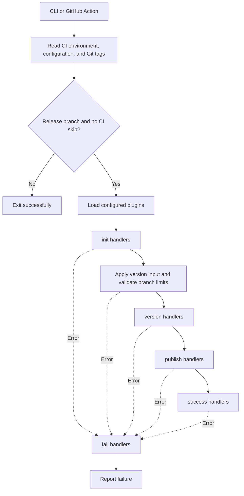

# Developer guide

[Contributing](../CONTRIBUTING.md) · [First change](maintainer-guide.md#your-first-change) · [Release examples](release-examples.md) · [API reference](typedoc/globals.md)

## Design principles

Use these principles when changing core or writing plugins:

- **CI agnostic:** GitHub Actions is the primary integration, but general-purpose plugins should work on any CI supported by `env-ci`. Keep platform-specific behavior in plugins such as `@octorelease/github`.
- **Language agnostic:** Core coordinates releases without requiring an npm project. Keep language and package-manager behavior in plugins such as `@octorelease/npm` and `@octorelease/pypi`.
- **Recoverable builds:** Check whether an operation already completed before running it. Reuse completed work and perform missing operations so a failed release can finish on a rerun.

Recovery checks belong to plugins. A rerun revisits the stages; core does not store a checkpoint. For example:

- npm checks whether a package version is already published.
- Git checks whether a version tag exists.
- GitHub reuses an existing release and skips assets already uploaded.

See [Recovering a partial release](support.md#recovering-a-partial-release) for retry guidance.

## Architecture

Core loads configuration and runs plugins for the selected branch. Plugins perform the release operations. The CLI and GitHub Action use the same core.



- Core awaits plugins in configuration order, once per option object.
- Handlers share a mutable `context`; their return values are ignored.
- `$cwd` and `$env` apply during a handler and are restored afterward, including on error.

| Stage | Responsibility | Example |
| --- | --- | --- |
| `init` | Validate prerequisites and populate context. Always runs. | npm reads `package.json`; GitHub optionally reads approved release labels. |
| `version` | Prepare release files and record changes. | Update a changelog, bump package metadata, then commit and tag with Git. |
| `publish` | Distribute the prepared artifacts. | Publish an npm tarball or upload GitHub assets. |
| `success` | Perform follow-up work. | Test package installation or comment on a PR. |
| `fail` | Report a failure from initialization, validation, or later stages. | Use `context.failError` to explain the failure. |

On failure:

- The current stage stops. Completed operations are not rolled back.
- `fail` handlers run for errors in initialization, validation, or later stages.
- Context-building and module-loading errors are reported directly.
- An error in a `fail` handler stops subsequent failure handlers.

### Source map

| Location | Responsibility |
| --- | --- |
| [`packages/core/src/main.ts`](../packages/core/src/main.ts) | CLI entry point and release orchestration. |
| [`packages/core/src/utils.ts`](../packages/core/src/utils.ts) | Configuration, context, plugin loading, and version validation. |
| [`packages/core/src/stages.ts`](../packages/core/src/stages.ts) | Stage ordering, skip controls, and temporary handler environment. |
| [`packages/core/src/doc`](../packages/core/src/doc) | Public TypeScript interfaces used by plugins. |
| `packages/<plugin>/src` | Plugin handlers and package-specific utilities. |
| [`esbuild.mjs`](../esbuild.mjs) | Bundles workspace source into the action's `dist/*.js` files. |
| [`action.yml`](../action.yml) | Action inputs and the `dist/index.js` entry point. |

The npm packages execute compiled `lib/` files. The action executes committed `dist/` files. See [build and test](../CONTRIBUTING.md#build-and-test) before testing source changes.

## JavaScript API

Use the exported functions and TypeScript types to build plugins and release scripts. The [API reference](typedoc/globals.md) documents their parameters and return values.

| API | Input and result |
| --- | --- |
| `utils.buildContext(options?)` | Reads configuration, CI data, and tags. Resolves to `IContext`, or `undefined` for an unmatched branch. Options can override the branch, force context creation, or set a log prefix. |
| `utils.loadPlugins(context)` | Loads configured modules and resolves to a map of plugin names to `IPlugin` exports. |
| `utils.verifyConditions(context)` | Applies version inputs and prerelease suffixes, updates overrides, and checks branch limits. Resolves without a value or throws. |
| `stages.init/version/publish/success/fail(context, plugins)` | Runs the selected stage. Resolves without a value or propagates a handler error. |
| `utils.dryRunTask(context, description, task)` | Runs and returns the async task's result normally. During a dry run, logs the skipped operation and resolves to `undefined`. |
| `Logger` | Logs debug, info, warning, and error messages with a plugin or explicit prefix. |

For example, inside a configured CI checkout, inspect the selected release without executing stages:

```js
const { utils } = require("@octorelease/core");

async function inspectRelease() {
  const context = await utils.buildContext({ logPrefix: "inspect" });
  if (!context) return;
  context.logger.info(JSON.stringify({
    branch: context.branch.name,
    previousVersion: context.version.old,
    plugins: Object.keys(context.plugins),
  }));
}

inspectRelease().catch((error) => {
  console.error(error.message);
  process.exitCode = 1;
});
```

Example log payload, before plugin initialization:

```json
{"branch":"main","previousVersion":"1.2.2","plugins":["@octorelease/npm"]}
```

- `force: true` bypasses branch matching. Configuration and a recognized CI environment are still required.
- When calling stages directly, provide your own validation and failure handling.

### Shared context

The full contract is [`IContext`](typedoc/interfaces/IContext.md). The most commonly used fields are:

| Field | How plugins use it |
| --- | --- |
| `version.old`, `version.new`, `version.overrides` | Read the previous and proposed versions; supply per-directory version overrides for workspaces. |
| `branch`, `ci`, `rootDir` | Identify the release channel, CI repository, and original release working directory. |
| `changedFiles` | Append paths relative to `rootDir` for the Git plugin to stage. |
| `releaseNotes` | Supply Markdown for a GitHub release. |
| `releasedPackages` | Record published packages for success handlers. |
| `dryRun`, `env`, `logger` | Respect preview mode, read credentials, and report progress. |
| `failError` | Read the original error in a failure handler. |

## Writing a plugin

Save this dependency-free example as `scripts/release-plugin.cjs` in a release project:

```js
const fs = require("node:fs/promises");
const path = require("node:path");

exports.init = async (context, config) => {
  if (typeof config.file !== "string" || !config.file.endsWith(".txt")) {
    throw new Error("release-plugin requires a .txt file option");
  }
  context.logger.info(`Will record version in ${config.file}`);
};

exports.version = async (context, config) => {
  const filePath = path.resolve(config.file);
  if (context.dryRun) {
    context.logger.info(`Would write ${context.version.new} to ${config.file}`);
    return;
  }
  await fs.writeFile(filePath, `${context.version.new}\n`);
  context.changedFiles.push(path.relative(context.rootDir, filePath));
};
```

Configure it before Git, with the file's parent directory already present:

```json
{
  "branches": ["main"],
  "plugins": [
    ["./scripts/release-plugin.cjs", { "file": "release-version.txt" }],
    "@octorelease/git"
  ]
}
```

- With `new-version: '1.2.3'`, the plugin writes `1.2.3` and a newline, then records the file for Git.
- A dry run logs the intended write.
- Supply the Git plugin's credentials and identity separately.

For a published TypeScript plugin:

- Export named handlers matching [`IPlugin`](typedoc/interfaces/IPlugin.md).
- Compile the code and set `package.json`'s `main` to the compiled entry point.
- Validate options during `init`.
- Read credentials from environment variables.
- Check for existing versions, tags, and assets before creating them.

### Errors and testing

Reject the handler promise with an `Error` containing an actionable message. Core reports the error and marks the command failed. See [troubleshooting](support.md#troubleshooting) for actual messages and remedies.

- Use a small context fixture and mock registry, Git, and GitHub calls.
- Check context changes, plugin order, dry runs, errors, and reruns after a partial release.
- Use each package's `__tests__` directory for examples.
- Run tests from the repository root; see [Contributing](../CONTRIBUTING.md#build-and-test).

## Generating API docs

Run `npm run typedoc` after changing core APIs or their comments.

- [typedoc.json](../typedoc.json) configures the Markdown output.
- `displayBasePath: "."` makes source paths relative to the repository root.
- `sourceLinkTemplate: "/{path}#L{line}"` creates source links with line anchors and no Git revision.
- GitHub resolves these links from the repository root on the current branch. Other Markdown viewers may interpret a leading `/` differently.
